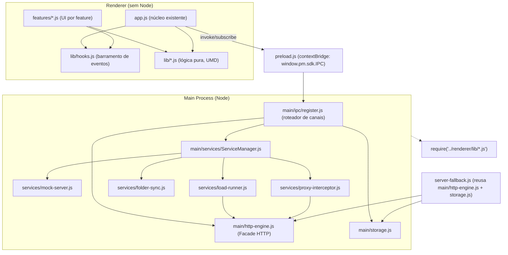

# Plano de Implementação — Carro do Ovo (Sprints 0–3)

> Documento destinado a **agentes implementadores**. Cada pacote de trabalho (WP) é autocontido: escopo, arquivos, contratos, critérios de aceite e testes. Leia as seções 1–4 antes de pegar qualquer WP.

**Backlog ativo:** US-60, US-61, US-63, US-64, US-65, US-67, US-68, US-69, US-70, US-71, US-72.
**Fora de escopo (futuro):** US-53 a US-59, US-62, US-66.

---

## 1. Estado atual (baseline verificada)

| Item | Situação |
| :--- | :--- |
| Runtime | Electron 35, Node 24.21, CommonJS, sem bundler, sem TypeScript |
| Main | [main.js](file:///c:/dev/carteiro/main.js) (659 linhas): storage JSON em `./data/`, motor HTTP (`executeHttpRequest`), proxy/mTLS, cookie jar, 3 canais IPC |
| Fallback web | [server-fallback.js](file:///c:/dev/carteiro/server-fallback.js) (602 linhas): **duplica** o motor HTTP e o storage do `main.js` |
| Preload | [preload.js](file:///c:/dev/carteiro/preload.js): expõe `window.pm.sdk.IPC.{invoke,send,subscribe}` via `contextBridge` |
| Renderer | [app.js](file:///c:/dev/carteiro/renderer/app.js) (6.094 linhas, script clássico monolítico, estado global `state`) + [index.html](file:///c:/dev/carteiro/renderer/index.html) (1.137 linhas) |
| Testes | **Inexistentes.** Sem pasta `test/`, sem script `test` |
| Versionamento | **Sem `.git`** no diretório |

Funções-chave do renderer que serão tocadas: `interpolateVariables` (L434), `getAllAvailableVariables` (L372), `evaluateAssertionsAndCaptures` (L1433), `executePostResponseScript` (L1680), `renderResponse` (L2913), `renderSidebar` (L3091), `executeTabRequestObject` (L3569), `sendActiveRequest` (L3728), `runCollectionSequentially` (L3786), `generateCodeSnippet` (L1000), `parseBruFile`/`generateBruContent` (L718/L800), `generateOvoContent`/`parseOvoFile` (L865/L957), geradores BR (L82–L133).

---

## 2. Arquitetura alvo

### 2.1 Princípios

1. **Local-First inegociável:** nenhum dado sai da máquina; servidores criados pelo app (Mock, Proxy) fazem bind **somente em `127.0.0.1`** por padrão.
2. **Zero build step:** continua sem bundler. Novos módulos devem rodar no Node (`require`) **e** no renderer (`<script>`), sem transpilar.
3. **Lógica pura separada de I/O e de DOM:** toda regra de negócio nova vive em `renderer/lib/` (pura, testável com `node:test`). DOM fica em `renderer/features/`. I/O de rede/disco fica em `main/`.
4. **Aditivo, não invasivo:** features novas entram como arquivos novos e se conectam ao `app.js` por um **barramento de hooks** (Sprint 0). Edição direta no `app.js` fica restrita a pontos de integração pequenos. Isso permite agentes em paralelo sem conflito de merge.
5. **Retrocompatibilidade de dados:** todo campo novo em `collections.json`, `settings.json` e `.ovo` é **opcional**, com default aplicado na leitura (migração preguiçosa). Nunca quebrar arquivos `.ovo` antigos.
6. **Segurança Electron:** manter `contextIsolation: true` e `nodeIntegration: false`. Novos canais IPC sempre via `ipcMain.handle` com validação de payload no main.

### 2.2 Visão de componentes



### 2.3 Estrutura de diretórios alvo

```text
carteiro/
├─ main.js                      # bootstrap: janela, ServiceManager, registro IPC (fica enxuto)
├─ preload.js                   # inalterado na API; só ganha canais na allowlist se adotada
├─ server-fallback.js           # passa a reusar main/http-engine.js e main/storage.js
├─ main/
│  ├─ storage.js                # readStore/writeStore + escrita atômica + CDO_DATA_DIR
│  ├─ http-engine.js            # executeHttpRequest extraído (proxy, mTLS, cookies, binário)
│  ├─ cookie-jar.js
│  ├─ ipc/register.js           # tabela de canais -> handlers, validação de payload
│  └─ services/
│     ├─ ServiceManager.js      # ciclo de vida (start/stop/stopAll) + graceful shutdown
│     ├─ mock-server.js         # US-63
│     ├─ proxy-interceptor.js   # US-71
│     ├─ folder-sync.js         # US-65
│     └─ load-runner.js         # US-61
├─ renderer/
│  ├─ index.html
│  ├─ app.js
│  ├─ lib/                      # PURO, UMD: roda em Node e no browser
│  │  ├─ hooks.js
│  │  ├─ interpolate.js         # núcleo de interpolação {{var}} / {{$gen}}
│  │  ├─ generators-br.js       # US-72 (+ migração dos geradores existentes)
│  │  ├─ json-table.js          # US-67
│  │  ├─ csv.js                 # US-67
│  │  ├─ schema-ir.js           # US-68/US-64: inferência JSON -> IR
│  │  ├─ type-emitters.js       # US-68: IR -> TS/Zod/Python/Java/Go/C#
│  │  ├─ json-schema.js         # US-64: IR -> JSON Schema + validador subset
│  │  ├─ poller.js              # US-70
│  │  ├─ stats.js               # US-61: percentis, RPS
│  │  ├─ assertions.js          # núcleo puro de assertions (extraído)
│  │  ├─ collection-tree.js     # US-69
│  │  ├─ route-matcher.js       # US-63
│  │  ├─ content-sniff.js       # US-60
│  │  └─ serializers/           # US-65: ovo.js, bru.js (Adapter)
│  └─ features/                 # DOM por feature (script clássico, IIFE)
│     ├─ response-viewers.js    # US-60
│     ├─ response-table.js      # US-67
│     ├─ type-generator.js      # US-68
│     ├─ auto-poll.js           # US-70
│     ├─ load-test.js           # US-61
│     ├─ mock-server-ui.js      # US-63
│     ├─ contract-schema.js     # US-64
│     ├─ sidebar-dnd.js         # US-69
│     ├─ folder-sync-ui.js      # US-65
│     └─ capture-ui.js          # US-71
└─ test/
   ├─ unit/                     # node:test, só renderer/lib/*
   ├─ integration/              # node:test, main/* com sockets reais (porta 0) e tmp dirs
   ├─ e2e/                      # Playwright _electron
   └─ fixtures/
```

### 2.4 Convenção de módulo UMD (obrigatória em `renderer/lib/`)

Permite `require()` no Node/main/testes e `<script src>` no renderer, sem bundler:

```js
// renderer/lib/csv.js
(function (root, factory) {
  const api = factory();
  if (typeof module === 'object' && module.exports) {
    module.exports = api;
  } else {
    root.CDO = root.CDO || {};
    root.CDO.csv = api;
  }
})(typeof globalThis !== 'undefined' ? globalThis : this, function () {
  'use strict';

  function toCsv(rows, { delimiter = ',', bom = false } = {}) {
    /* ... */
  }

  return { toCsv };
});
```

Regras para `lib/`:
- **Proibido** acessar `document`, `window`, `fetch`, `require('fs')`, `Date.now()` ou `Math.random()` diretamente. Relógio e RNG entram por injeção (`{ now, rng }`) para testes determinísticos.
- Uma responsabilidade por arquivo. Exportar só funções puras e classes sem efeitos colaterais.
- Ordem de carga no `index.html`: `lib/*.js` → `app.js` → `features/*.js`.

### 2.5 Barramento de hooks (renderer)

`renderer/lib/hooks.js` implementa um **Observer** simples (`on`, `off`, `emit`, `emitAsync`). O `app.js` passa a emitir:

| Evento | Payload | Emitido em |
| :--- | :--- | :--- |
| `app:ready` | `{ state }` | fim de `init()` |
| `request:beforeSend` | `{ tab, spec }` (mutável) | `executeTabRequestObject`, antes do IPC |
| `request:completed` | `{ tab, response }` | após assertions/scripts |
| `response:rendered` | `{ tab, container }` | fim de `renderResponse` |
| `sidebar:rendered` | `{ container }` | fim de `renderSidebar` |
| `tab:activated` / `tab:closed` | `{ tabId }` | troca/fechamento de aba |
| `collection:changed` | `{ collectionId, reason }` | após `persistStore('collections')` |

Features **só** se conectam por hooks e por funções públicas expostas em `window.CDO.app` (ex.: `getActiveTab`, `renderAll`, `persistStore`, `createBlankTab`, `interpolateVariables`, `executeTabRequestObject`). O Sprint 0 cria essa fachada.

### 2.6 Contrato IPC

Prefixo `pm:<domínio>:<ação>`. Request/response via `invoke`; eventos de streaming via `webContents.send` + `subscribe`. Todo handler retorna `{ ok: true, ...data }` ou `{ ok: false, error: { code, message } }`. Nunca lançar exceção para o renderer.

| Canal | Tipo | Sprint | Payload → Retorno |
| :--- | :--- | :--- | :--- |
| `pm:storage:loadAll` / `pm:storage:save` | invoke | existente | inalterado |
| `pm:runtime:request` | invoke | existente / S1 | retorno ganha `bodyEncoding`, `contentType`, `truncated` |
| `pm:load:start` | invoke | S2 | `{ spec, variables, concurrency, iterations?, durationMs?, assertions }` → `{ runId }` |
| `pm:load:stop` | invoke | S2 | `{ runId }` → `{ ok }` |
| `pm:load:progress` / `pm:load:done` | evento | S2 | snapshot de `stats` (throttle 250 ms) |
| `pm:mock:start` / `pm:mock:stop` / `pm:mock:status` | invoke | S2 | `{ collectionId, port, host, cors }` → `{ url, routes[] }` |
| `pm:mock:log` | evento | S2 | `{ method, path, matchedItemId, status, ms }` |
| `pm:sync:pickFolder` | invoke | S3 | → `{ dirPath }` (usa `dialog.showOpenDialog`) |
| `pm:sync:enable` / `pm:sync:disable` / `pm:sync:flush` | invoke | S3 | `{ collectionId, dirPath, format }` |
| `pm:sync:changed` / `pm:sync:conflict` | evento | S3 | `{ collectionId, items[] }` |
| `pm:capture:start` / `pm:capture:stop` / `pm:capture:clear` | invoke | S3 | `{ port }` → `{ url }` |
| `pm:capture:entry` | evento | S3 | `{ id, method, url, status, reqHeaders, resHeaders, ... }` |

> [!IMPORTANT]
> O fallback web (`server-fallback.js`) só suporta os canais `pm:storage:*` e `pm:runtime:request`. Canais de serviço (`mock`, `capture`, `sync`, `load`) devem responder `{ ok: false, error: { code: 'UNSUPPORTED_IN_WEB_MODE' } }`, e a UI deve esconder ou desabilitar esses botões.

---

## 3. Padrões de projeto adotados

| Padrão | Onde | Motivo |
| :--- | :--- | :--- |
| **Facade** | `main/http-engine.js` | API única `execute(spec, opts)` escondendo proxy CONNECT, mTLS, cookies, binário. Reusado por runtime, load runner, proxy e fallback. Elimina duplicação com `server-fallback.js`. |
| **Registry** | `generators-br.js` (`{{$nome}}`), `type-emitters.js`, `response-viewers.js` | Adicionar gerador, linguagem ou viewer = registrar uma entrada. Toolbox, autocomplete e manual leem do registry (fonte única). |
| **Strategy** | Emissores de tipos (TS/Zod/…), viewers por `Content-Type`, matcher de rotas do mock | Algoritmos intercambiáveis com a mesma interface. |
| **Intermediate Representation** | `schema-ir.js` | Inferência JSON feita **uma vez** e consumida por US-68 (tipos) e US-64 (JSON Schema). |
| **Adapter** | `serializers/ovo.js`, `serializers/bru.js` | Interface comum `{ ext, serializeRequest, parseRequest, serializeCollectionMeta, parseCollectionMeta }` para o Folder Sync. |
| **Observer** | `lib/hooks.js` no renderer; `EventEmitter` nos serviços do main | Desacopla features do núcleo e transmite logs/progresso. |
| **Command + State Machine** | `poller.js` (`idle → running → succeeded / failed / stopped / timeout`) | Ciclo previsível, cancelável e testável com timers mockados. |
| **Lifecycle / Disposable** | `ServiceManager` + interface `{ name, start(cfg), stop(), status() }` | Graceful shutdown: `app.on('before-quit')` chama `stopAll()` com timeout de 3 s. |
| **Semaphore / Worker Pool** | `load-runner.js` | Concorrência limitada, sem dependência externa. |
| **Ring Buffer** | `proxy-interceptor.js` (500 entradas), logs do mock (1.000) | Memória limitada em sessões longas. |
| **Dependency Injection leve** | Todos os módulos de `lib/` e `services/` recebem `{ now, rng, fs, engine, logger }` opcionais | Testes determinísticos sem mocks globais. |

### 3.1 Padrões de código (skills `node` + `electron`)

- **Erros:** classe base `CdoError extends Error { code, details }` em `main/errors.js`. Erros **operacionais** (rede, timeout, porta ocupada `EADDRINUSE`, permissão de pasta) viram `{ ok:false, error }`. Erros de **programação** são logados com contexto e propagados. Registrar `process.on('unhandledRejection')` e `process.on('uncaughtException')` no main com log em `./data/logs/main.log`.
- **Async:** `async/await` sempre; nada de callbacks novos. Timeouts com `AbortSignal.timeout()` quando aplicável. Nenhum `await` dentro de loop quando a concorrência for desejada; usar o pool.
- **Streams:** corpo de resposta lido com limite (`maxResponseBytes`, default 50 MB). Ao exceder, abortar e retornar `truncated: true`. Para escrita em disco (download, sync), usar `pipeline()` de `node:stream/promises`.
- **Escrita em disco:** sempre atômica (`writeFile(tmp)` + `rename`) em `main/storage.js` e no Folder Sync.
- **Electron:** nenhum `require` de módulo Node no renderer. Novos handlers validam tipo e tamanho do payload. `dialog` e `Notification` são usados apenas no main.
- **Estilo:** 2 espaços, aspas simples, ponto e vírgula, `const` por padrão, nomes em inglês no código, textos de UI em pt-BR. **Preservar todos os comentários existentes.**
- **UI:** reutilizar classes CSS existentes (`btn-small`, `chain-box`, `env-profile-config-card`, `modal-backdrop`, `res-tests-list`, `kv-table`). Nada de framework novo. Todo texto vindo da resposta HTTP é inserido via `textContent`, nunca `innerHTML`.

---

## 4. Modelo de dados (mudanças, todas opcionais)

| Entidade | Campo novo | Tipo / Default | US |
| :--- | :--- | :--- | :--- |
| `settings` | `maxResponseBytes` | `number` / `52428800` | 60 |
| `settings` | `poll` | `{ intervalMs: 2000, maxAttempts: 30, notify: true }` | 70 |
| `settings` | `mock` | `{ port: 4000, host: '127.0.0.1', cors: true }` | 63 |
| `settings` | `capture` | `{ port: 8888 }` | 71 |
| `collection` | `folders` | `string[]` (caminhos `"Auth/OAuth"`, permite pasta vazia) / `[]` | 69 |
| `collection` | `sync` | `{ enabled:false, dirPath:'', format:'ovo', lastSyncAt:null }` | 65 |
| `item` | `folder` | **mantido** como `string`; passa a aceitar caminho aninhado com `/` | 69 |
| `item` | `mockExamples` | `[{ id, name, status, headers[], body, delayMs, isDefault }]` / `[]` | 63 |
| `item` | `contract` | `{ responseSchema: object \| null, enabled: boolean }` | 64 |
| `assertion` | `source: 'schema'`, `operator: 'matches'` | novo valor de enum | 64 |
| resposta (cache) | `bodyEncoding`, `contentType`, `truncated` | `'utf8' \| 'base64'`, `string`, `boolean` | 60 |

> [!WARNING]
> **Não persistir corpo binário grande.** Em `sessions.responseCache` e em `item.history`, salvar `body` base64 apenas se for ≤ 1 MB. Acima disso, salvar `{ omitted: true, sizeBytes, contentType }`. Isso evita inflar `sessions.json` e `collections.json`.

O formato `.ovo` mantém a versão atual. Os novos campos são exportados quando presentes e ignorados por versões antigas. `parseOvoFile` aplica os defaults.

---

## 5. Roadmap e paralelização

```mermaid
flowchart LR
  S0["Sprint 0 — Fundação (1 agente, serial)"] --> S1
  subgraph S1["Sprint 1 — Quick Wins"]
    A72["US-72 Geradores BR"]
    A68["US-68 IR + Tipos"]
    A67["US-67 Tabela/CSV"]
    A60["US-60 Viewers binários"]
    A70["US-70 Auto-Poll"]
  end
  S1 --> S2
  subgraph S2["Sprint 2 — Qualidade & Mock"]
    A64["US-64 JSON Schema (usa IR da US-68)"]
    A69["US-69 DnD + pastas"]
    A63["US-63 Mock Server"]
    A61["US-61 Teste de carga"]
  end
  S2 --> S3
  subgraph S3["Sprint 3 — Git & Captura"]
    A65["US-65 Folder Sync (usa árvore da US-69)"]
    A71["US-71 Proxy Interceptor"]
  end
```



| Sprint | Lanes paralelas sugeridas | Dependências duras |
| :--- | :--- | :--- |
| 0 | 1 lane | nenhuma |
| 1 | Lane A: US-72 · Lane B: US-68 → US-67 · Lane C: US-60 · Lane D: US-70 | todas dependem do Sprint 0 |
| 2 | Lane A: US-64 · Lane B: US-69 · Lane C: US-63 · Lane D: US-61 | US-64 ← US-68 (IR); US-61 ← `interpolate.js` + `assertions.js` (S0) |
| 3 | Lane A: US-65 · Lane B: US-71 | US-65 ← US-69 (`collection-tree.js`) + serializers |

> [!IMPORTANT]
> Regra de colisão: cada lane **só edita** seus arquivos novos, mais o trecho do `index.html` e do `app.js` explicitamente listado no WP. Alterações em `main/http-engine.js` dentro do mesmo sprint pertencem a **uma** lane (US-60 no S1, US-71 no S3).

---

## 6. Sprint 0 — Fundação (pré-requisito obrigatório)

**Objetivo:** criar infraestrutura de testes, desacoplar o núcleo e eliminar a duplicação main/fallback, **sem mudar comportamento visível**.

| WP | Tarefa | Arquivos | Aceite |
| :--- | :--- | :--- | :--- |
| S0-1 | `git init` + `.gitignore` (`node_modules/`, `dist/`, `data/`, `test/.tmp/`) e commit baseline | raiz | repositório criado antes de qualquer alteração |
| S0-2 | Scripts de teste no `package.json`: `test`, `test:unit`, `test:integration`, `test:e2e`, `test:coverage` | `package.json` | `npm test` roda (mesmo com 0 testes) |
| S0-3 | Override de diretório de dados: `CDO_DATA_DIR` tem precedência sobre `BASE_DIR/data` | `main.js`, `server-fallback.js` → `main/storage.js` | E2E consegue isolar dados em pasta temporária |
| S0-4 | Extrair `main/storage.js` (escrita atômica) e `main/http-engine.js` + `main/cookie-jar.js` de `main.js`. `server-fallback.js` passa a importar os mesmos módulos | `main/*`, `main.js`, `server-fallback.js` | Testes de caracterização (S0-7) passam antes e depois; `server-fallback.js` perde ≥ 400 linhas |
| S0-5 | `main/services/ServiceManager.js` + `main/errors.js` + handlers globais de erro + `before-quit` → `stopAll()` | `main/*`, `main.js` | Teste unitário de ciclo de vida verde |
| S0-6 | `renderer/lib/hooks.js` + fachada `window.CDO.app`, emissão dos eventos da seção 2.5 no `app.js` | `renderer/lib/hooks.js`, `app.js`, `index.html` | Nenhuma regressão manual; hooks testados |
| S0-7 | **Testes de caracterização** do motor HTTP (GET/POST JSON, urlencoded, multipart, auth basic/bearer/apikey, cookie jar, timeout, proxy HTTP com servidor fake) | `test/integration/http-engine.test.js` | ≥ 15 casos verdes contra servidor local em porta 0 |
| S0-8 | Extrair núcleos puros: `lib/interpolate.js` (recebe `variables` + `generators`), `lib/assertions.js` (avaliação de assertion isolada do DOM) e mover os geradores existentes para `lib/generators-br.js` | `renderer/lib/*`, `app.js` | `app.js` delega para a lib; testes unitários cobrem os casos atuais |
| S0-9 | Smoke E2E: abrir app, enviar GET para servidor local, ver status 200 | `test/e2e/smoke.spec.js` | verde em Windows |

---

## 7. Sprint 1 — Quick Wins

### US-72 — Geradores Fintech/ERP BR

**Arquivos:** `renderer/lib/generators-br.js` (expandir), `index.html` (toolbox gerado a partir do registry), `app.js` (autocomplete lê do registry).

**Design:** registry `[{ token, label, category, generate(rng), validate?(value) }]`. Cada gerador tem um validador correspondente, usado nos testes. Validadores ficam só na API da lib e não viram tokens `{{$...}}`.

| Token | Regra |
| :--- | :--- |
| `{{$randomPixPayload}}` | BR Code EMV estático: IDs `00`, `26` (GUI `br.gov.bcb.pix` + chave aleatória e-mail/UUID), `52=0000`, `53=986`, `58=BR`, `59` nome, `60` cidade, `62` txid, `63` **CRC16-CCITT-FALSE** (poly `0x1021`, init `0xFFFF`) em hex maiúsculo |
| `{{$randomBoleto}}` | Linha digitável de 47 dígitos: 3 campos com DV **módulo 10**, DV geral **módulo 11** sobre o código de barras de 44 dígitos, fator de vencimento e valor |
| `{{$randomCartaoCredito}}` | Prefixos de teste Visa (`4`) e Mastercard (`51`–`55`), 16 dígitos, DV **Luhn** |
| `{{$randomPlacaMercosul}}` | Padrão `LLLNLNN` |
| `{{$randomCEP}}` | 8 dígitos, sem máscara (variante `{{$randomCEPFormatado}}` com hífen) |
| `{{$randomInscricaoEstadualSP}}` | Algoritmo de IE de SP (12 dígitos, 2 DVs) |

**Aceite:** cada token funciona em URL, headers, body e scripts; aparece no autocomplete `{{`; tem botão na toolbox; consta no manual.
**Testes:** unitários com RNG semeado; 1.000 gerações por token passam no validador; vetores conhecidos de CRC16 (`"123456789"` → `29B1`) e Luhn.

### US-68 — Gerador de Tipos da Resposta

**Arquivos:** `lib/schema-ir.js`, `lib/type-emitters.js`, `features/type-generator.js`, `index.html` (botão `🧬 Tipos` na toolbar da resposta e opção no modal Code).

**Design da IR:**
```js
// Nó da IR
{ kind: 'object', fields: [{ name, node, optional }] }
{ kind: 'array', items: Node }
{ kind: 'union', variants: Node[] }
{ kind: 'string' | 'integer' | 'number' | 'boolean' | 'null' | 'unknown', formats?: ['date-time'|'uuid'|'email'] }
```
- Arrays de objetos: mesclar chaves; campo ausente em algum elemento vira `optional: true`.
- `null` + tipo vira `union` com `null`, renderizado como nullable em cada linguagem.
- Profundidade máxima 20; nomes de tipos derivados do caminho (`RootItem`, `RootItemAddress`), com dedupe estrutural.
- Emitters (Strategy): `typescript` (interface), `zod`, `python` (Pydantic v2), `java` (record), `go` (struct com tags `json`), `csharp` (record). Chaves inválidas como identificador recebem anotação de alias.

**Aceite:** gera código compilável para os fixtures; nome raiz configurável; botão copiar.
**Testes:** snapshot por emitter sobre 8 fixtures (objeto simples, aninhado, array heterogêneo, nullable, array vazio, chaves com hífen, números int/float, raiz array). Teste opcional de compilação TS com `tsc --noEmit` se disponível (pular se ausente).

### US-67 — Resposta JSON em Tabela + CSV

**Arquivos:** `lib/json-table.js`, `lib/csv.js`, `features/response-table.js`, `index.html` (botão `📊 Tabela` ao lado de Pretty/Raw).

**Design:**
- `toTable(value, { maxDepth: 1 })` aceita o JSON **após o filtro** `resJsonFilterInput`. Array de objetos vira colunas (união de chaves, ordem de primeira aparição). Objetos aninhados são achatados com `a.b`. Arrays internos ficam como JSON compacto.
- Botão desabilitado quando o valor não for array de objetos (tooltip explica).
- Ordenação por coluna (numérica/texto, estável). Renderização em lotes de 500 linhas + "Carregar mais".
- CSV RFC 4180 (aspas, quebras de linha, `""`). Opções: delimitador `,` ou `;` (padrão `;` para Excel pt-BR) e BOM UTF-8.

**Testes:** unitários (`toTable`, escape CSV, ordenação); performance: 10.000 linhas × 20 colunas → `toTable` < 200 ms; primeira renderização < 1 s (E2E).

### US-60 — Viewers Binário, Imagem, PDF e HTML

**Arquivos:** `main/http-engine.js`, `lib/content-sniff.js`, `features/response-viewers.js`, `app.js` (`renderResponse` delega ao registry de viewers), `index.html`.

**Design:**
- Main: `content-sniff.isTextual(contentType, firstBytes)`. Texto → `body` utf8. Binário → `body` base64 + `bodyEncoding: 'base64'`. Limite `maxResponseBytes` com `truncated: true`.
- Renderer: registry de viewers `{ id, label, match(contentType, encoding), render(container, response) }`:
  - `json` / `text` (existentes)
  - `image/*` → `` com `Blob` + `URL.createObjectURL` (revogar ao trocar de aba)
  - `application/pdf` → `<iframe>` com blob URL (validar o viewer PDF do Electron; fallback é botão "Abrir externamente")
  - `text/html` → `<iframe sandbox="" srcdoc>` **sem** `allow-scripts`, alternável com Raw
  - outros binários → card com tipo, tamanho, hexdump dos primeiros 256 bytes e "Baixar"
- `btnDownloadResponse` passa a baixar os bytes reais (decodificar base64 em `Uint8Array`) com extensão derivada do `Content-Type`.
- Respeitar a regra de não persistência da seção 4.

**Testes:** integração no engine (PNG, PDF, gzip binário, UTF-8 com acentos, resposta > limite); unitários de `content-sniff`; E2E: imagem renderizada (`naturalWidth > 0`), download com hash SHA-256 igual ao original, HTML com `<script>` **não** executa.

### US-70 — Auto-Poll Condicional

**Arquivos:** `lib/poller.js`, `features/auto-poll.js`, `index.html` (botão `⏱` ao lado de `Send` + popover de configuração).

**Design (state machine):**
```js
const poller = new Poller({ intervalMs, maxAttempts, timeoutMs, send, evaluate, sleep, now });
poller.on('attempt', ...); poller.on('done', ({ state, attempts, lastResponse }) => ...);
await poller.start(); poller.stop();
```
- `evaluate(response)` usa as assertions da aba (`lib/assertions.js`). Para em sucesso, `maxAttempts`, `timeoutMs`, `stop()` manual, fechamento da aba (`tab:closed`) ou erro de rede repetido 3 vezes.
- Intervalo mínimo 500 ms. A espera conta **após** a resposta (sem sobreposição).
- Trava anti-acidente: se o profile exige confirmação e o método é destrutivo, confirmar **uma vez** antes de iniciar.
- Feedback: contador na aba, status bar e notificação nativa opcional via `Notification` do HTML5.
- Cada tentativa entra no histórico da requisição; a última resposta é exibida.

**Testes:** unitários com `mock.timers` do `node:test` (sucesso na 3ª tentativa, timeout, stop manual, erro de rede, intervalo respeitado); E2E contra servidor local que muda de `PROCESSING` para `COMPLETED` na 3ª chamada.

---

## 8. Sprint 2 — Qualidade, Mock e Organização

### US-64 — Contrato JSON Schema

**Arquivos:** `lib/json-schema.js`, `features/contract-schema.js`, `app.js` (assertion `schema`), extensão de `pm.response.to.have.jsonSchema(schema)` em `executePostResponseScript`.

**Design:**
- `irToJsonSchema(ir)` gera draft 2020-12. Um botão `📐 Gerar contrato` salva em `item.contract.responseSchema`, e o JSON Schema fica editável num textarea.
- Validador **próprio, subset documentado:** `type` (incl. array de tipos), `properties`, `required`, `items`, `enum`, `const`, `additionalProperties`, `minItems`/`maxItems`, `minLength`/`maxLength`, `minimum`/`maximum`, `format` (date-time, uuid, email). Keywords desconhecidas emitem aviso, nunca falha silenciosa.
- Erros reportados com caminho JSON Pointer (`/items/0/id: esperado integer, recebido string`).

**Testes:** unitários do gerador (fixtures da US-68) e do validador (tabela de ≥ 30 casos válidos e inválidos); integração com runner: contrato quebrado aparece em Test Results.

### US-69 — Drag-and-Drop e Pastas Aninhadas

**Arquivos:** `lib/collection-tree.js`, `features/sidebar-dnd.js`, `app.js` (`renderSidebar` usa `buildTree`), exportadores Postman/.ovo/.bru.

**Design:**
- `item.folder` aceita `"Auth/OAuth/Admin"`. O caractere `/` passa a ser proibido em nomes de pasta individuais.
- API pura: `buildTree(collection)`, `moveItem(collections, { itemId, toCollectionId, toFolder, index })`, `renameFolder(collection, oldPath, newPath)` (renomeia o prefixo de todos os itens e das `folders`), `deleteFolder(collection, path, { mode: 'moveToParent' | 'deleteItems' })`, `createFolder`.
- A ordem é a ordem do array `items`. Sem campo `order`.
- UI: HTML5 Drag and Drop, indicador de drop (antes/depois/dentro), auto-expand ao pairar 600 ms. Alternativa de teclado: `Alt+↑/↓` reordena e `Alt+←/→` sobe/desce nível.
- Abas abertas vinculadas continuam apontando para o item movido (`collectionId` atualizado).
- Export Postman v2.1: pastas aninhadas viram `item` groups aninhados. Import Postman: groups aninhados viram caminhos `a/b`.

**Testes:** unitários de toda a API da árvore (mover entre coleções, renomear prefixo sem afetar `Auth2`, deletar com os 2 modos, idempotência); roundtrip export/import Postman preservando a hierarquia; E2E de arrastar item para outra pasta e reiniciar o app para confirmar persistência.

### US-63 — Mock Server Local

**Arquivos:** `main/services/mock-server.js`, `lib/route-matcher.js`, `features/mock-server-ui.js`, `index.html` (botão `🎭` no menu da collection + aba "Exemplos de Mock" no item).

**Design:**
- `route-matcher.compile(items, variables)`: remove `{{base_url}}` e esquema/host, normaliza a barra final. Segmentos `:id`, `{id}` e `{{var}}` viram parâmetros. Pontuação de especificidade: literal 3, parâmetro 2, curinga 1. Empate é resolvido pela ordem na collection.
- Resposta: `x-mock-example: <nome>` → exemplo nomeado; senão `isDefault`; senão primeiro exemplo; senão última entrada do `item.history` com status; senão `404 { error, availableRoutes }`. Header opcional `x-mock-status` força o status.
- `delayMs` por exemplo. CORS ligado por padrão (responde preflight `OPTIONS`). Bind em `127.0.0.1`. Porta 0 = automática. `EADDRINUSE` vira erro operacional amigável.
- Interpolação de geradores no body do exemplo (`{{$uuid}}`) usando `lib/interpolate.js` no main.
- "Salvar resposta atual como exemplo" na toolbar da resposta.
- Registro no `ServiceManager`: o servidor para ao sair, e o rebuild de rotas acontece em `collection:changed` (debounce 300 ms).

**Testes:** unitários do matcher (especificidade, params, trailing slash, query ignorada, métodos); integração subindo o mock em porta 0 e testando com o próprio `http-engine` (exemplo nomeado, delay, CORS, 404 com rotas, `EADDRINUSE`, `stop()` libera a porta); E2E: start, enviar request do app para `http://127.0.0.1:<porta>`, ver o log.

### US-61 — Teste de Carga Leve

**Arquivos:** `main/services/load-runner.js`, `lib/stats.js`, `features/load-test.js`, modal do runner (`runnerModal`) ganha aba "⚡ Carga".

**Design:**
- Execução **no main** (evita throttling do renderer). O renderer resolve antes do envio os encadeamentos `{{@Req...}}` e as variáveis do environment num snapshot. O main interpola os geradores dinâmicos por requisição com `lib/interpolate.js`.
- Modos: N iterações **ou** duração (máx. 5 min). Concorrência de 1 a 200 (semáforo). Ramp-up linear opcional. `http.Agent({ keepAlive: true, maxSockets: concurrency })`.
- Assertions avaliadas com `lib/assertions.js` (sem scripts `pm.*` no modo carga; a UI avisa).
- `stats`: total, sucesso/erro, taxa de erro, RPS, min/média/max, p50/p90/p95/p99 (ordenação de array, com amostragem reservoir acima de 100 mil amostras), histograma de status codes.
- Progresso por evento a cada 250 ms; cancelamento imediato via `pm:load:stop` (aborta sockets).
- **Guardas:** confirmação obrigatória se o profile ativo tiver trava anti-acidente ou contorno colorido; aviso fixo "Use apenas em ambientes que você controla".

**Testes:** unitários de `stats` (percentis contra valores conhecidos, reservoir); integração contra servidor local com latência artificial (concorrência máxima observada no servidor ≤ configurada, contagem exata de requisições, stop interrompe em < 500 ms, erros contabilizados); sem E2E pesado, só um smoke.

---

## 9. Sprint 3 — Git Sync e Captura

### US-65 — Live Folder Sync

**Arquivos:** `main/services/folder-sync.js`, `renderer/lib/serializers/{ovo,bru}.js` (extrair de `generateBruContent`, `parseBruFile`, `generateOvoContent`, `parseOvoFile`), `features/folder-sync-ui.js`.

**Design:**
- Layout no disco (um arquivo por request, amigável a diffs):
  ```text
  <dirPath>/
    collection.ovo            # metadados: id, nome, auth, variáveis (sem segredos), folders[]
    Auth/
      login.ovo
      OAuth/
        refresh-token.ovo
    listar-posts.ovo
  ```
- Serialização determinística: chaves ordenadas, 2 espaços, `\n` final, sem `history` nem `response` (dados voláteis ficam só em `./data/`).
- **UI → disco:** em `collection:changed`, o renderer envia o snapshot e o main calcula o diff (hash por arquivo) e escreve atomicamente. Renomear o item renomeia o arquivo.
- **Disco → UI:** `fs.watch(dir, { recursive: true })` com debounce de 300 ms. **Supressão de eco:** mapa `path → sha256` do último conteúdo escrito; eventos com o mesmo hash são ignorados.
- **Conflito:** arquivo alterado externamente enquanto a aba está suja (`isTabDirty`) gera `pm:sync:conflict` com as opções "Manter minha versão", "Usar versão do disco" e "Ver diff" (reusa `historyDiffModal`).
- **Segurança:** todo caminho é resolvido e validado dentro de `dirPath` (bloqueia `..`). Variáveis `secret: true` são escritas com valor vazio e um aviso. A pasta é escolhida só via `dialog.showOpenDialog`.
- Arquivo inválido no disco: o item não é removido; o erro aparece na UI com o caminho do arquivo.

**Testes:** unitários dos serializers (roundtrip `.ovo` e `.bru` preservando campos; determinismo byte a byte); integração com `fs.mkdtemp` (enable gera a árvore esperada; editar arquivo externo emite `changed`; escrita própria **não** emite evento; rename; delete; path traversal rejeitado; arquivo corrompido não derruba o serviço); E2E: habilitar sync, editar URL no app e conferir o arquivo no disco.

### US-71 — Proxy Interceptor (Captura de Tráfego)

**Arquivos:** `main/services/proxy-interceptor.js`, `features/capture-ui.js`, `index.html` (botão `📡 Capturar` na topbar + modal de captura).

**Design (MVP):**
- Servidor HTTP em `127.0.0.1:<porta>`, padrão 8888.
- Requisições HTTP com URI absoluta: encaminhar via `http-engine` e capturar request e response (corpo limitado a 1 MB por lado).
- `CONNECT` (HTTPS): **túnel transparente sem decriptação**. Registra só `host:port`, duração e bytes, com rótulo "HTTPS — conteúdo criptografado".
- Ring buffer de 500 entradas. Eventos `pm:capture:entry` com throttle.
- UI: lista com filtro (método, host, status), detalhe da entrada, ações "Abrir em nova aba" (usa `createBlankTab`) e "Salvar na Collection", seleção múltipla.
- Headers sensíveis (`Authorization`, `Cookie`, `Set-Cookie`) mascarados na lista e preservados ao salvar, com aviso.
- Instruções na UI para configurar o proxy no sistema, navegador ou emulador.

> [!NOTE]
> Decriptação HTTPS (MITM com CA local) fica **fora do escopo** deste sprint por risco de segurança e complexidade. Ela deve ser uma US futura separada.

**Testes:** integração com cliente → proxy → servidor de destino local (captura correta de método, URL, headers e corpo; truncamento em 1 MB; túnel CONNECT para servidor TLS local com certificado autoassinado funciona e registra metadados; ring buffer descarta os mais antigos; `stop()` libera a porta; bind apenas em loopback); E2E: capturar uma requisição e salvar na collection.

---

## 10. Plano de Testes

### 10.1 Pirâmide e ferramentas

| Camada | Ferramenta | Escopo | Meta |
| :--- | :--- | :--- | :--- |
| Unitário | `node:test` + `node:assert/strict` (nativo, sem dependência) | `renderer/lib/**` | ≥ 90% de linhas em `lib/` |
| Integração | `node:test` + sockets reais em porta 0 + `fs.mkdtemp` | `main/**` | todo serviço com start/stop/erro/limite |
| E2E | `@playwright/test` com `_electron.launch` (devDependency) | fluxos críticos por US | 1–3 specs por US |
| Manual | checklist por US (seção 10.5) | UX, visual, Windows/Linux | executado antes do aceite do sprint |

Scripts (`package.json`):
```json
{
  "test": "node --test test/unit test/integration",
  "test:unit": "node --test test/unit",
  "test:integration": "node --test test/integration",
  "test:coverage": "node --test --experimental-test-coverage test/unit test/integration",
  "test:e2e": "playwright test test/e2e"
}
```

> [!TIP]
> No PowerShell desta máquina, `npx` e `npm` são bloqueados pela execution policy. Use `npm.cmd` e `npx.cmd`.

### 10.2 Regras para testes

- **Determinismo:** RNG e relógio injetados; `mock.timers` para o poller; nenhuma chamada a hosts externos (JSONPlaceholder proibido em testes).
- **Isolamento:** cada teste de integração sobe seu servidor em porta 0 e fecha no `after()`. E2E usa `CDO_DATA_DIR` apontando para `test/.tmp/<uuid>`.
- **Sem processos pendurados:** todo servidor, watcher e timer é fechado em `t.after()`. Rodar com `--test-timeout=20000`. Se travar, diagnosticar com a regra `stuck-processes-and-tests` da skill `node`.
- **Fixtures** em `test/fixtures/`: JSONs de resposta, PNG 1×1, PDF mínimo, coleções `.ovo` antigas (garantem retrocompatibilidade), arquivos `.bru` e Postman.
- **Caracterização antes de refatorar:** o Sprint 0 fixa o comportamento atual do motor HTTP e da interpolação antes de qualquer extração.

### 10.3 Testes de regressão obrigatórios (todo sprint)

1. Importar `.ovo` antigo (fixture) → sem erro, todas as requests abrem.
2. Request chaining `{{@Req.json.campo}}` continua resolvendo.
3. Proxy HTTP + túnel CONNECT, mTLS (com certificado de teste) e ignore SSL continuam funcionando.
4. Collection Runner sequencial com data file CSV.
5. Trava anti-acidente bloqueia `DELETE` sem confirmação.
6. Fallback web (`npm run web`) carrega a UI, envia requisição e esconde as features exclusivas do Electron.

### 10.4 Budgets de performance

| Cenário | Limite |
| :--- | :--- |
| Abrir app com 50 collections × 100 requests | UI interativa < 2 s |
| Tabela 10.000 linhas | primeira renderização < 1 s |
| Resposta binária 20 MB | sem travar a UI (> 30 fps no scroll) e download íntegro |
| Load test 50 concorrentes contra servidor local | overhead do runner < 5 ms por requisição em p50 |
| Folder Sync de 500 requests | sync inicial < 3 s, eco suprimido 100% |

### 10.5 Checklist manual por US (modelo)

- [ ] Funciona nos temas Dark e Light.
- [ ] Funciona nos 4 layouts de split (vertical/horizontal, normal/invertido).
- [ ] Textos em pt-BR, tooltips explicativos, sem `innerHTML` com dados externos.
- [ ] Estado persiste após reiniciar o app.
- [ ] Exportar e importar `.ovo` preserva os campos novos.
- [ ] Manual (modal e `MANUAL.md`) atualizado com a feature.
- [ ] Modo web (`npm run web`) degrada com elegância.

---

## 11. Definition of Done (por US)

1. Código segue as seções 2–4 (UMD em `lib/`, hooks, IPC padronizado, campos opcionais).
2. Testes unitários e de integração verdes; cobertura de `lib/` da feature ≥ 90%.
3. Pelo menos 1 spec E2E verde para o fluxo principal.
4. Regressões da seção 10.3 verdes.
5. Checklist manual da seção 10.5 completo.
6. Manual in-app e `MANUAL.md` atualizados; nenhum comentário preexistente removido.
7. Commit isolado por US com mensagem `feat(US-xx): <resumo>`.

---

## 12. Riscos e mitigações

| Risco | Impacto | Mitigação |
| :--- | :--- | :--- |
| `app.js` monolítico gera conflitos entre agentes | Alto | Sprint 0 cria hooks e fachada; features ficam em arquivos novos; regra de colisão da seção 5 |
| Refatoração do motor HTTP quebra proxy/mTLS | Alto | Testes de caracterização (S0-7) antes da extração |
| Memória com respostas binárias grandes em base64 | Médio | `maxResponseBytes`, não persistir > 1 MB, revogar blob URLs |
| `fs.watch` inconsistente entre SOs | Médio | Debounce, supressão por hash, rescan completo a cada 30 s como fallback |
| Viewer PDF indisponível em iframe no Electron | Baixo | Fallback "Abrir externamente" via `shell.openPath` de arquivo temporário |
| Mock ou proxy expostos na rede local | Alto | Bind fixo em `127.0.0.1`; mudar o host exige confirmação explícita com aviso |
| Teste de carga contra produção por engano | Alto | Confirmação obrigatória com profile protegido, limite de 200 concorrentes e 5 min |

---

## 13. Decisões em aberto (para o PO confirmar)

1. **US-72:** Inscrição Estadual apenas de SP no MVP, ou também MG, RJ e PR?
2. **US-65:** formato padrão de sync `.ovo` (recomendado) ou `.bru`?
3. **US-60:** limite padrão `maxResponseBytes` de 50 MB está adequado?
4. **E2E:** aceitar `@playwright/test` como devDependency (só desenvolvimento, não vai no build)?
5. Copiar este plano para o repositório (`docs/PLANO_IMPLEMENTACAO.md`) para que os agentes implementadores tenham acesso?
